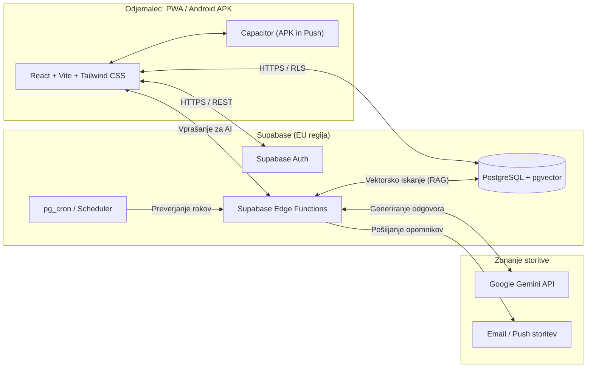

# Arhitektura sistema in načrtovane tehnologije

## 1. Pregled arhitekture

Aplikacija **Auslender SI** temelji na sodobni brezstrežniški (serverless) arhitekturi. Odjemalec je zasnovan kot **napredna spletna aplikacija (PWA)** z možnostjo pakiranja v **Android APK**, zaledni del pa temelji na platformi **Supabase** (PostgreSQL + `pgvector` + Edge Functions) in AI modelu **Google Gemini**.

---

## 2. Izbrane tehnologije in utemeljitev

### Frontend (PWA in mobilna aplikacija)
* **React (Vite) + TypeScript + Tailwind CSS:** Omogoča hiter razvoj odzivnega uporabniškega vmesnika, prilagojenega mobilnim zaslonom. TypeScript zagotavlja tipsko varnost med odjemalcem in zalednimi storitvami.
* **PWA (`vite-plugin-pwa`):** Aplikacija deluje neposredno v mobilnem brskalniku z možnostjo namestitve na domači zaslon (*Add to Home Screen*) brez potrebe po objavi v trgovinah App Store ali Google Play.
* **Capacitor:** Omogoča pakiranje iste spletne kode v namestitveno datoteko **Android `.apk`** ter dostop do nativnih zmožnosti naprave (npr. potisna obvestila).

### Zaledni sistem (Backend) in baza podatkov
* **Supabase (PostgreSQL):** Relacijska baza podatkov je najprimernejša za jasno hierarhijo podatkov (*postopek → koraki → dokumenti → napredek uporabnika → opomniki*).
* **Row Level Security (RLS):** Varnostna pravila na ravni vrstic omogočajo, da neprijavljeni uporabniki berejo javne podatke (postopke, korake, dokumente), prijavljeni uporabniki pa lahko berejo in urejajo izključno svoj napredek ter opomnike.
* **Supabase Auth:** Upravljanje registracije in prijave uporabnikov (e-pošta in geslo).
* **Supabase Edge Functions (TypeScript):** Varno izvajanje zaledne logike (klici na Gemini API in pošiljanje obvestil), tako da API ključi nikoli niso izpostavljeni na odjemalcu.

### AI asistent (RAG arhitektura)
* **Google Gemini API + `pgvector`:** Za zanesljive in točne odgovore sistem uporablja pristop **RAG (Retrieval-Augmented Generation)**:
  1. Uporabnik pošlje vprašanje na Supabase Edge Function.
  2. Funkcija pretvori vprašanje v vektor in v tabeli `baza_znanja_rag` (`pgvector`) poišče najbolj relevantne odseke preverjenih uradnih navodil.
  3. Najdeni odseki in vprašanje se posredujejo modelu **Gemini API** z navodilom, naj odgovarja izključno na podlagi priloženih virov in navede povezave do njih.
  4. Če ustreznih podatkov v bazi znanja ni, asistent to jasno navede.
* Pogovor z AI asistentom je **začasen** (shranjen le v pomnilniku odjemalca za čas seje), zato se zgodovina klepeta ne shranjuje v bazo.

### Obvestila in opomniki
* Prijavljeni uporabniki lahko nastavijo opomnike za roke in dokumente.
* Načrtovana naloga (`pg_cron`) periodično sproži Edge Function, ki preveri zapadle opomnike in uporabniku pošlje **e-poštno sporočilo** (prek SMTP / Resend) in/ali **potisno obvestilo (Push)** (Web Push / Firebase Cloud Messaging prek Capacitorja).

### Gostovanje in skladnost z GDPR
* **Gostovanje odjemalca (PWA):** Vercel ali Netlify (samodejna objava ob spremembah v Git repozitoriju).
* **Regija podatkov:** Supabase projekt bo nameščen v **EU regiji** (npr. Frankfurt – `eu-central-1`) zaradi skladnosti z uredbo GDPR