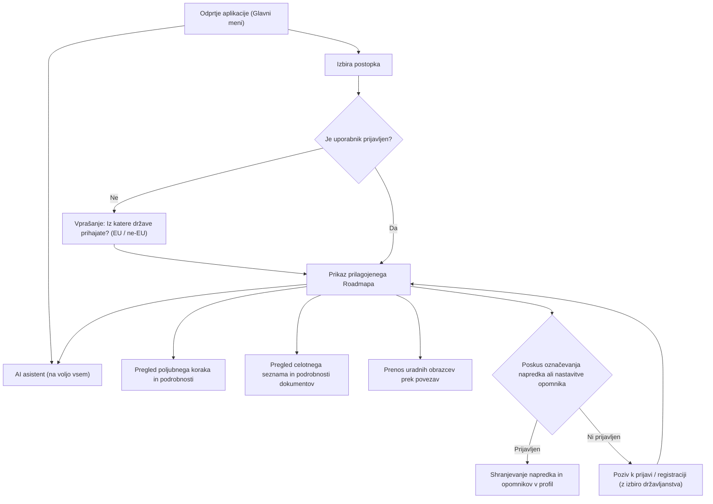

# Opis projekta, funkcionalnosti in delovni tok

## 1. Opis problema in cilj projekta

Tuji študenti ob prihodu in bivanju v Sloveniji naletijo na številne birokratske ovire. Informacije o pridobitvi in podaljšanju dovoljenja za prebivanje ter odprtju bančnega računa so razpršene po različnih spletnih straneh (eUprava, upravne enote, fakultete, banke), pogosto zapisane v zapletenem pravnem jeziku in na voljo le v slovenščini.

**Auslender SI** rešuje ta problem tako, da uporabniku ponudi enotno, pregledno in večjezično mobilno rešitev, ki zapletene postopke razdeli na jasne korake, prikaže točen seznam potrebnih dokumentov in omogoča sproten nadzor nad napredkom.

---

## 2. Vloge uporabnikov in funkcionalnosti

Aplikacija omogoča takojšen dostop do vseh informacij brez obvezne registracije, hkrati pa prijavljenim uporabnikom ponuja shranjevanje napredka in opomnike.

### Neprijavljeni uporabnik (`Uporabnik`)
* **Sprememba jezika:** Preklop med slovenskim (`SL`), angleškim (`EN`) in srbskim (`SR`) jezikom.
* **Izbira postopka na glavnem meniju:** Dostop do vseh podprtih postopkov takoj ob odprtju aplikacije.
* **Izbira državljanstva ob vstopu v postopek:** Ker uporabnik ni prijavljen, ga aplikacija ob izbiri postopka vpraša, iz katere države prihaja (EU ali ne-EU), in na tej podlagi prikaže ustrezen seznam korakov in dokumentov.
* **Pregled navodil po korakih (Roadmap):** Prost vpogled v vse korake postopka in njihove podrobnosti.
* **Pregled seznama in podrobnosti dokumentov:** Celoten seznam potrebnih dokumentov s pojasnili o namenu, načinu pridobitve in pristojni ustanovi.
* **Dostop do uradnih obrazcev:** Neposredne povezave za prenos uradnih PDF obrazcev in dostop do pristojnih portalov.
* **AI asistent:** Postavljanje vprašanj o postopkih in dokumentih v začasnem pogovoru.
* **Registracija in prijava:** Ustvarjanje uporabniškega računa (z izbiro državljanstva) ali prijava v obstoječi račun.

### Prijavljeni uporabnik (`Prijavljeni uporabnik`)
Poleg vseh funkcionalnosti neprijavljenega uporabnika ima dostop še do:
* **Shranjenega profila:** Državljanstvo (EU / ne-EU) se izbere ob registraciji, zato aplikacija ob kasnejšem vstopu v postopke tega vprašanja ne postavlja več.
* **Označevanja opravljenih korakov:** Shranjevanje trenutnega stanja na časovnici postopka.
* **Označevanja pripravljenih dokumentov:** Odkljukavanje že zbranih dokumentov.
* **Pregleda napredka:** Vizualni prikaz odstotka dokončanosti in števila pripravljenih dokumentov (npr. *2 / 5 dokumentov pripravljenih – 40 %*).
* **Nastavitve opomnikov:** Ustvarjanje opomnikov za roke oddaje vlog in veljavnost dokumentov z obveščanjem prek e-pošte in potisnih obvestil (Push).

---

## 3. Uporabniški tok (Workflow)

Spodnji diagram prikazuje potek uporabe aplikacije za neprijavljenega in prijavljenega uporabnika:

---

## 4. Načrtovane nadgradnje v prihodnosti (izven obsega MVP)

* **Skeniranje in nalaganje dokumentov:** Slikanje dokumentov s kamero telefona ter osnovna OCR preverba čitljivosti.
* **Samodejno izpolnjevanje obrazcev:** Lokalno predizpolnjevanje PDF obrazcev z osebnimi podatki uporabnika na napravi.
* **Dodatni postopki:** Prijava na fakulteto, pridobitev davčne številke, študentsko delo in prijava začasnega prebivališča.