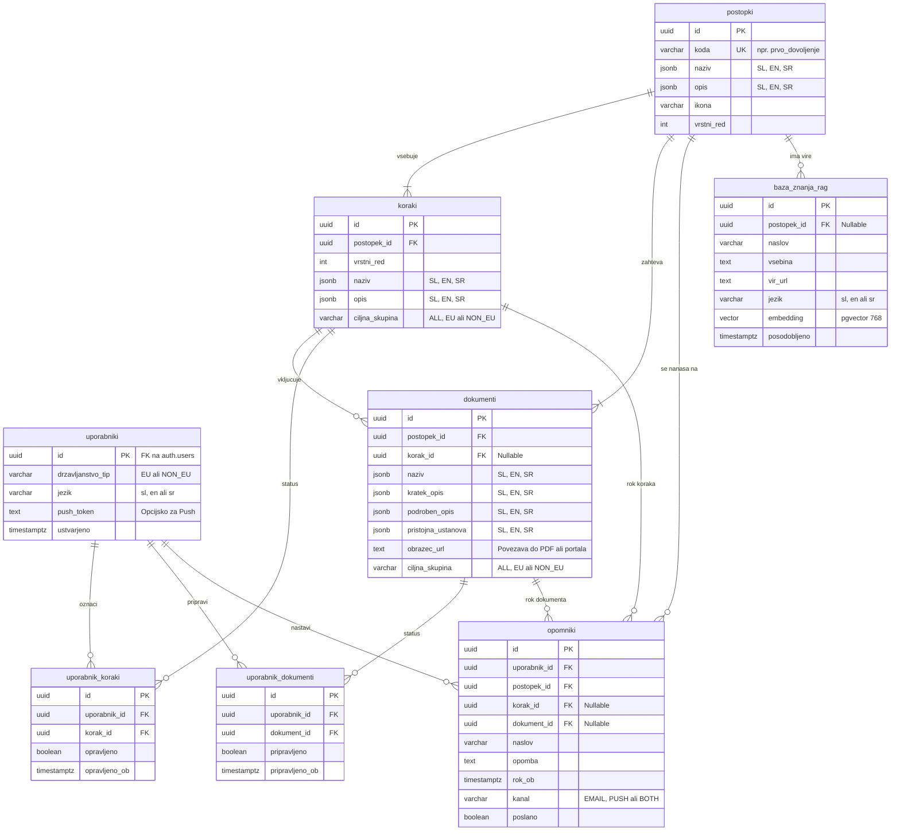

# Začetni podatkovni model

Podatkovni model je zasnovan za relacijsko bazo podatkov **PostgreSQL (Supabase)** z razširitvijo **`pgvector`** za semantično iskanje pri AI asistentu.

## 1. Ključne zasnovne odločitve

1. **Večjezičnost prek `JSONB`:** Besedilna polja v več jezikih (`sl`, `en`, `sr`) so shranjena kot `JSONB` objekti v obliki `{"sl": "...", "en": "...", "sr": "..."}`. To ohranja shemo pregledno in poenostavlja poizvedbe brez podvajanja tabel za prevode.
2. **Lahka dinamična prilagoditev (EU / ne-EU):** Koraki in dokumenti vsebujejo atribut `ciljna_skupina` z vrednostmi `ALL`, `EU` ali `NON_EU`. Skupni dokumenti (npr. potni list, fotografija) se ne podvajajo, aplikacija pa dinamično filtrira seznam glede na uporabnikovo državljanstvo.
3. **Brez shranjevanja uporabniških datotek in zgodovine AI:** Za uradne obrazce se hranijo izključno povezave za prenos (`obrazec_url`), pogovor z AI asistentom pa je začasen.

---

## 2. ER diagram

---

## 3. Opis tabel

| Tabela | Namen |
|---|---|
| **`uporabniki`** | Razširitev sistemske tabele `auth.users` v Supabase. Hrani nastavitve prijavljenega uporabnika (tip državljanstva `EU`/`NON_EU`, izbrani jezik in žeton za potisna obvestila). |
| **`postopki`** | Šifrant podprtih administrativnih postopkov (prvo dovoljenje, podaljšanje, bančni račun). |
| **`koraki`** | Posamezni koraki znotraj postopka, razvrščeni po `vrstni_red`, s filtrom `ciljna_skupina` (`ALL`, `EU`, `NON_EU`). |
| **`dokumenti`** | Potrebni dokumenti za postopek (opcijsko vezani tudi na konkreten korak), z navodili za pridobitev, pristojno ustanovo in povezavo do uradnega obrazca (`obrazec_url`). |
| **`uporabnik_koraki`** | Evidenca opravljenih korakov za prijavljenega uporabnika (edinstvena kombinacija `uporabnik_id` + `korak_id`). |
| **`uporabnik_dokumenti`** | Evidenca pripravljenih dokumentov za prijavljenega uporabnika (edinstvena kombinacija `uporabnik_id` + `dokument_id`), ki omogoča izračun napredka (npr. 40 %). |
| **`opomniki`** | Uporabniško nastavljeni opomniki za roke in dokumente s kanalom obveščanja (`EMAIL`, `PUSH`, `BOTH`) in zastavico `poslano`. |
| **`baza_znanja_rag`** | Preverjeni vsebinski odseki iz uradnih virov z vektorskimi vložitvami (`embedding`) za semantično iskanje pri AI asistentu. |